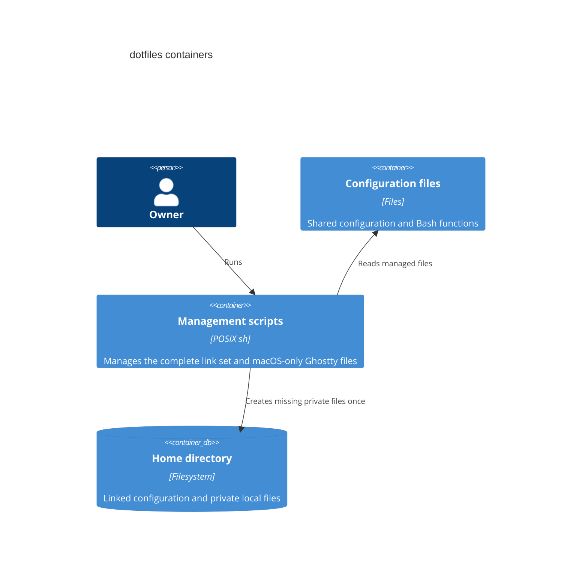

# C2: Containers

The scripts preflight every managed file link and deploy the shared `bash/`
configuration. Bash detects the platform for macOS Homebrew paths and Linux mise
initialization; interactive integrations only load in interactive shells.
Ghostty is macOS-only. The installer links Git, Bash, Starship, Neovim, and dprint files
using `~/.bashrc`, `~/.bash_profile`, and files below `~/.config`. It also links
`AGENTS.md` into existing tool directories.
`~/.bash_secrets`, `~/.config/git/credentials`, and `config.local`
remain ordinary local files. Secrets load after the default shell environment
and can override it. Uninstall preserves private files.
