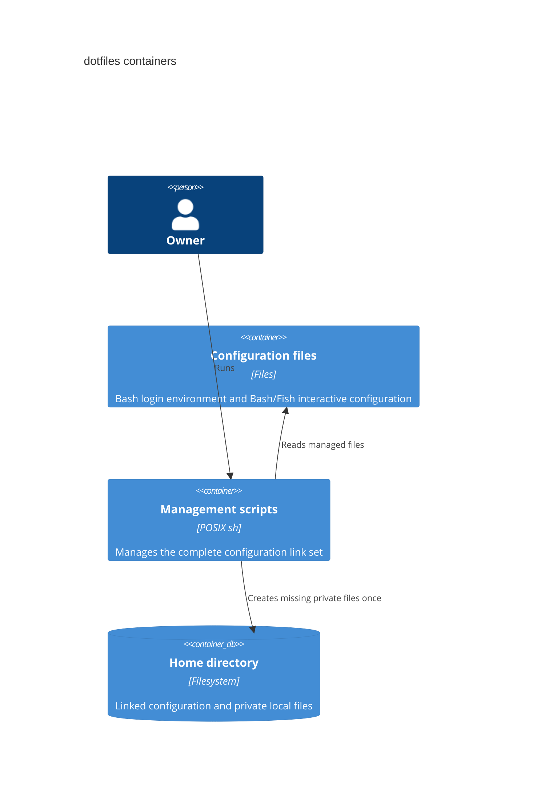

# C2: Containers

The scripts preflight every managed file link and deploy the shared `bash/` and
`fish/` configurations. The Bash login profile initializes the environment and
loads `~/.secrets`; interactive Bash also loads `.bashrc` for aliases,
history, fzf, zoxide, and Starship. Fish starts only when explicitly invoked and
inherits the exported environment and provides clipboard and Mihomo functions.
Starship identifies the current shell in the prompt. Non-interactive login shells initialize only
the environment. On Linux, Bash adds mise shims to PATH for non-interactive
programs, and both Bash and Fish activate mise hooks during interactive use.
The installer links Git, Bash, Fish, Starship, Neovim, and dprint files using
`~/.gitconfig`, `~/.bashrc`, `~/.bash_profile`, and files below `~/.config`.
It also links `AGENTS.md` into existing tool directories.
`~/.secrets` and `~/.git-credentials` remain ordinary local files. Secrets use
Bash syntax, load after the default environment, and can override it. Uninstall
preserves private files.
