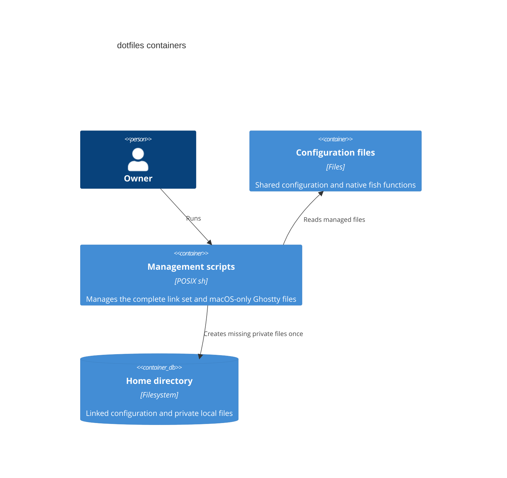

# C2: Containers

The scripts preflight every managed file link and deploy the shared `fish/`
configuration. Fish detects the platform for macOS Homebrew paths and Linux mise
initialization; interactive integrations only load in interactive shells.
Ghostty is macOS-only. The installer links Git, fish, Starship, Neovim, and dprint files
below `~/.config` and links `AGENTS.md` into existing tool directories.
`~/.config/fish/secrets.fish`, `~/.config/git/credentials`, and `config.local`
remain ordinary local files. Secrets load after the default shell environment
and can override it. Uninstall preserves private files.
